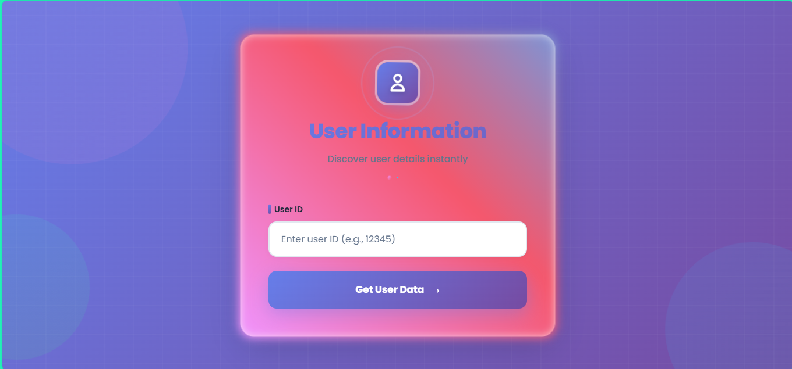
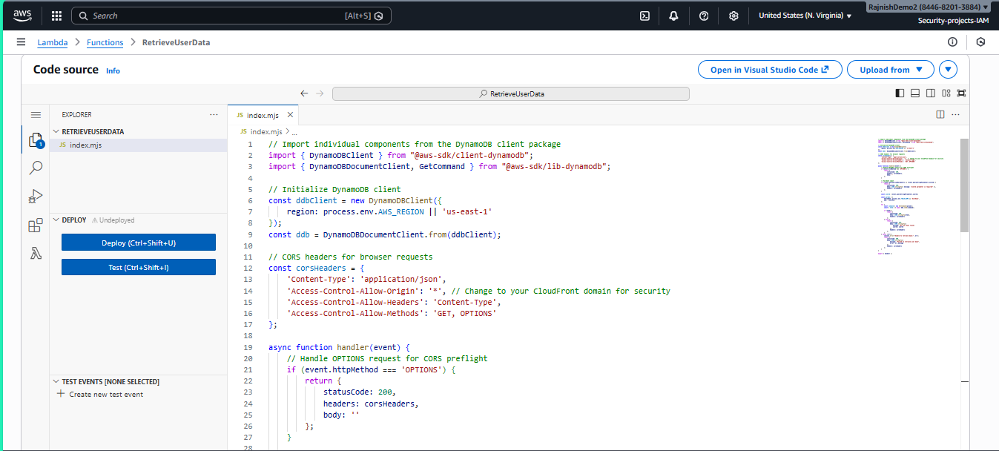
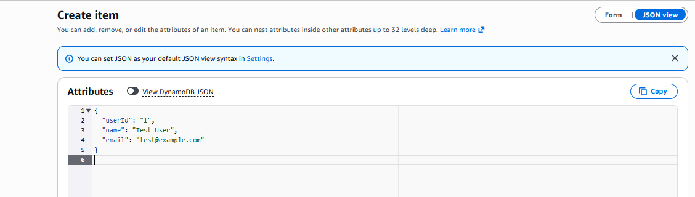
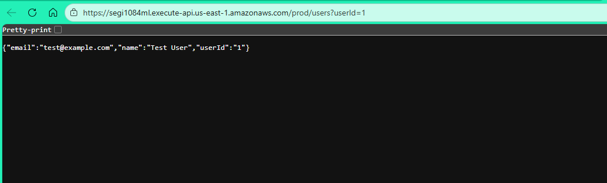
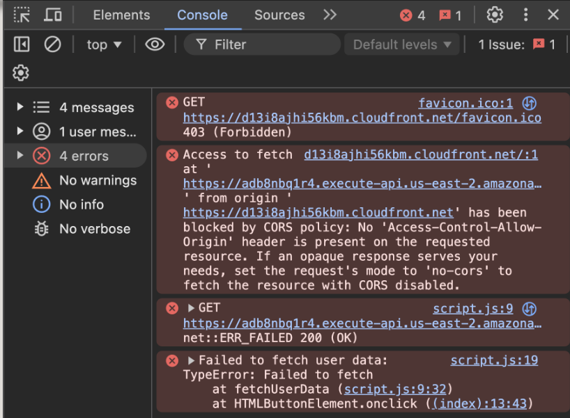
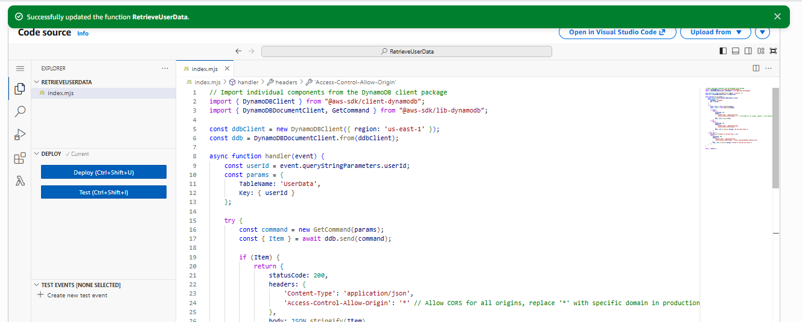
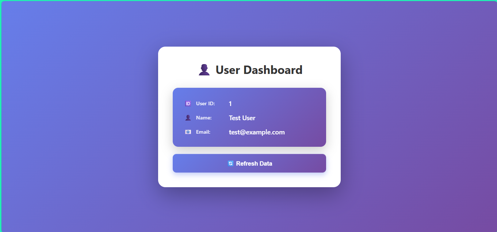

# AWS Serverless Three-Tier Web Application

## Project Overview

Designed and deployed a serverless three-tier web application on Amazon Web Services (AWS) using Amazon S3, CloudFront, API Gateway, Lambda, and DynamoDB.

This project demonstrates how frontend, business logic, and database layers can work together without managing servers, resulting in a scalable, cost-effective, and highly available cloud-native architecture.

---

# Architecture

## Three-Tier Design

### Presentation Tier
- Amazon S3
- Amazon CloudFront

### Logic Tier
- AWS Lambda
- Amazon API Gateway

### Data Tier
- Amazon DynamoDB

## Architecture Flow

```text
User
 │
 ▼
CloudFront
 │
 ▼
S3 Static Website
 │
 ▼
API Gateway
 │
 ▼
Lambda Function
 │
 ▼
DynamoDB
```

## Solution Architecture



The application follows a serverless three-tier architecture where CloudFront delivers frontend content hosted in Amazon S3, API Gateway provides REST API endpoints, Lambda processes application logic, and DynamoDB stores application data.

---

# Architecture Walkthrough

## 1. Amazon S3 Configuration



Amazon S3 hosts the frontend static website assets, including HTML, CSS, and JavaScript files.

### Key Responsibilities
- Static website hosting
- Frontend asset storage
- High durability and availability

---

## 2. CloudFront Distribution



Amazon CloudFront distributes website content globally through AWS Edge Locations, improving performance and reducing latency for end users.

### Key Benefits
- Faster content delivery
- Improved user experience
- Enhanced security through HTTPS support

---

## 3. API Gateway Configuration



Amazon API Gateway exposes REST endpoints that allow the frontend application to interact securely with backend services.

### Key Responsibilities
- API request handling
- Endpoint management
- Request routing to Lambda

---

## 4. Lambda Function



AWS Lambda contains the application's business logic and processes requests received from API Gateway.

### Key Responsibilities
- Process incoming requests
- Query DynamoDB
- Return responses to the frontend

---

## 5. DynamoDB Table



Amazon DynamoDB acts as the application's NoSQL database, storing and retrieving data efficiently without server management.

### Database Configuration

```text
Partition Key: userId
```

### Key Responsibilities
- Data storage
- Fast lookups
- Scalability

---

## 6. Final Working Application



Final application demonstrating successful integration between the frontend, backend, and database layers.

### Validation Results
- Frontend successfully served through CloudFront
- API Gateway endpoint functional
- Lambda processing requests correctly
- DynamoDB returning expected data
- End-to-end application workflow verified

---

# AWS Services Used

| Service | Purpose |
|----------|----------|
| Amazon S3 | Static website hosting |
| Amazon CloudFront | Global content delivery |
| Amazon API Gateway | REST API endpoints |
| AWS Lambda | Backend application logic |
| Amazon DynamoDB | NoSQL database |
| AWS IAM | Service permissions and security |

---

# Features

- Fully serverless architecture
- Static website hosting
- Global content delivery via CloudFront
- REST API integration
- Dynamic backend processing
- NoSQL database storage
- Scalable and cost-effective design
- Minimal infrastructure management

---

# Implementation Steps

## Presentation Tier

Frontend assets were hosted in Amazon S3 and distributed globally through CloudFront.

### Responsibilities

- Host static web content
- Improve availability
- Reduce latency through caching

---

## Logic Tier

AWS Lambda was integrated with API Gateway to process application requests dynamically.

### Responsibilities

- Handle user requests
- Process business logic
- Query DynamoDB

---

## Data Tier

Amazon DynamoDB was configured as the backend database for data persistence.

### Responsibilities

- Store application data
- Retrieve user information
- Support serverless backend operations

---

# Challenges Faced

## API Integration Issues

During implementation, API calls initially failed because the frontend application was not configured with the correct API Gateway endpoint.

### Resolution

- Verified API Gateway deployment
- Updated frontend API URLs
- Re-uploaded application files to S3

---

## CORS Configuration Errors

Browser requests were blocked due to Cross-Origin Resource Sharing (CORS) restrictions between frontend and backend services.

### Resolution

- Enabled CORS in API Gateway
- Updated Lambda response headers
- Tested cross-origin requests successfully

---

# Testing and Validation

The solution was tested using the following workflow:

1. Accessed the application through CloudFront.
2. Submitted a sample request from the frontend.
3. Sent the request to API Gateway.
4. Processed request data through Lambda.
5. Retrieved records from DynamoDB.
6. Returned results to the frontend application.

### Outcome

Successful end-to-end communication between all three tiers confirmed that the architecture was functioning correctly.

---

# Security Considerations

- IAM-based access control
- Principle of least privilege
- CORS access restrictions
- No direct database exposure
- API access controlled through API Gateway
- Reduced attack surface through serverless services

---

# Key Learnings

This project provided hands-on experience with:

- Serverless AWS architecture
- Amazon CloudFront
- Amazon API Gateway
- AWS Lambda
- Amazon DynamoDB
- Cross-service integration
- CORS troubleshooting
- Cloud-native application design

---

# Business Value

This architecturelivery
- Improved reliability and availability
- Simplified infrastructure management

---

# Future Improvements

- User authentication using Amazon Cognito
- Infrastructure as Code (Terraform)
- CI/CD deployment through GitHub Actions
- Monitoring using Amazon CloudWatch
- Custom domain integration with Amazon Route 53
- Web Application Firewall (AWS WAF)

---
## Original Project Reference

This project was originally completed as part of the NextWork Cloud Engineering learning path.

To showcase practical cloud engineering skills, this repository was expanded with:

- Professional documentation
- Architecture diagrams
- Implementation details
- Security considerations
- Project walkthroughs
- Screenshots
- Lessons learned

These additions go beyond the original project deliverables and better demonstrate real-world AWS cloud engineering practices.

---

# Project Status

✅ Completed

---

# Author

## Rajnish Jha

Aspiring Cloud & DevOps Engineer focused on AWS, Linux, Docker, Git, and automation.

### Connect With Me

- LinkedIn: https://www.linkedin.com/in/rajnish-k-jha
- GitHub: https://github.com/VortexSentinel
